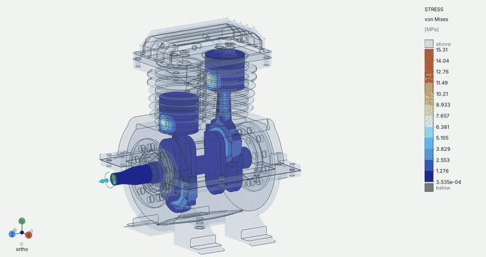
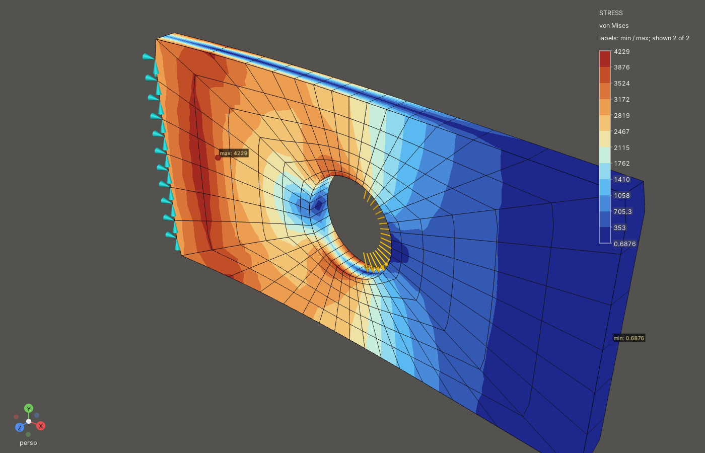
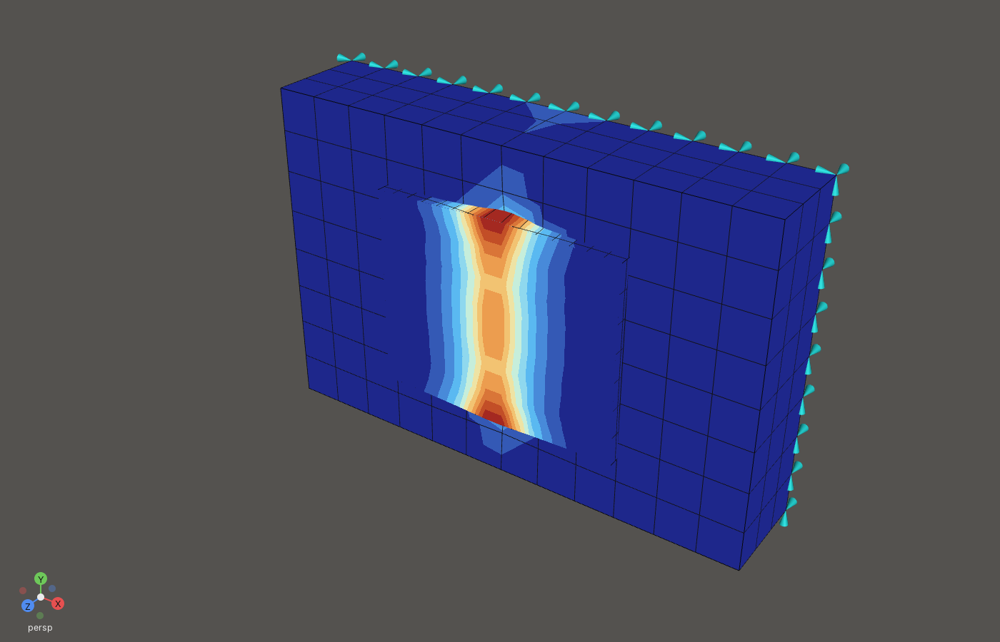
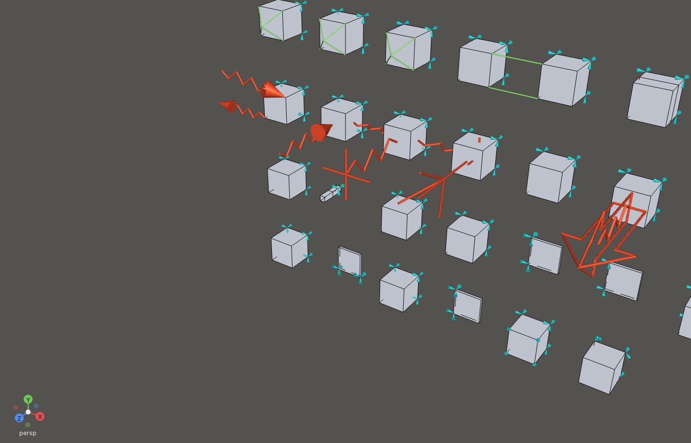
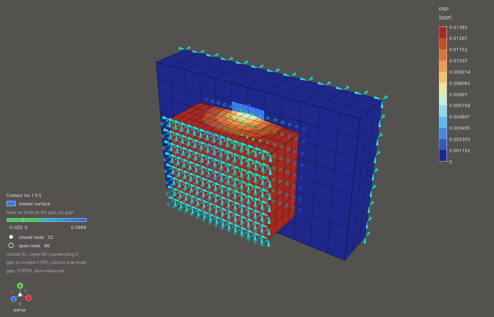
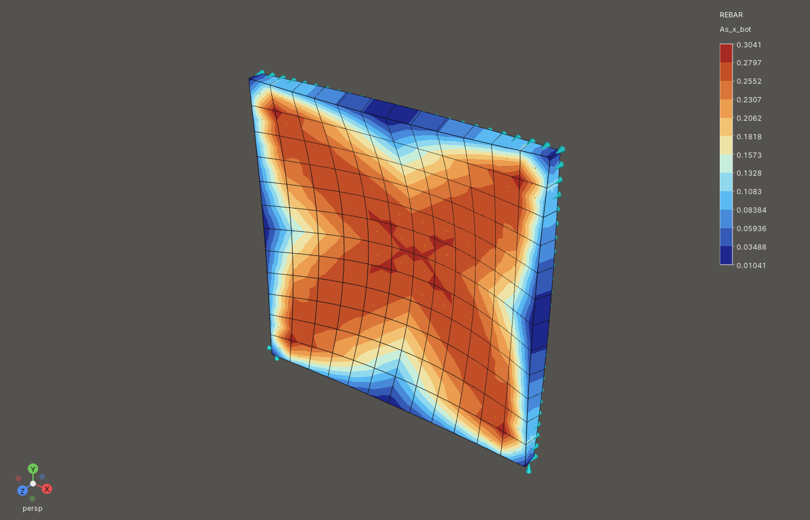
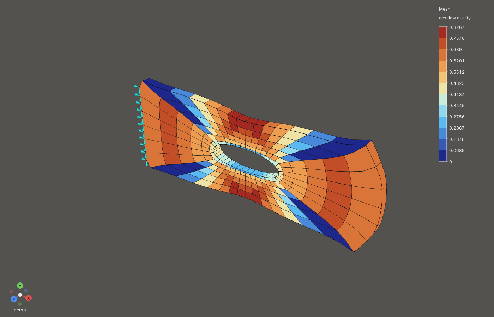
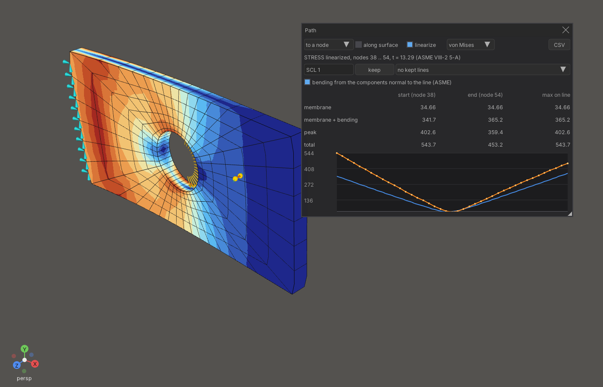
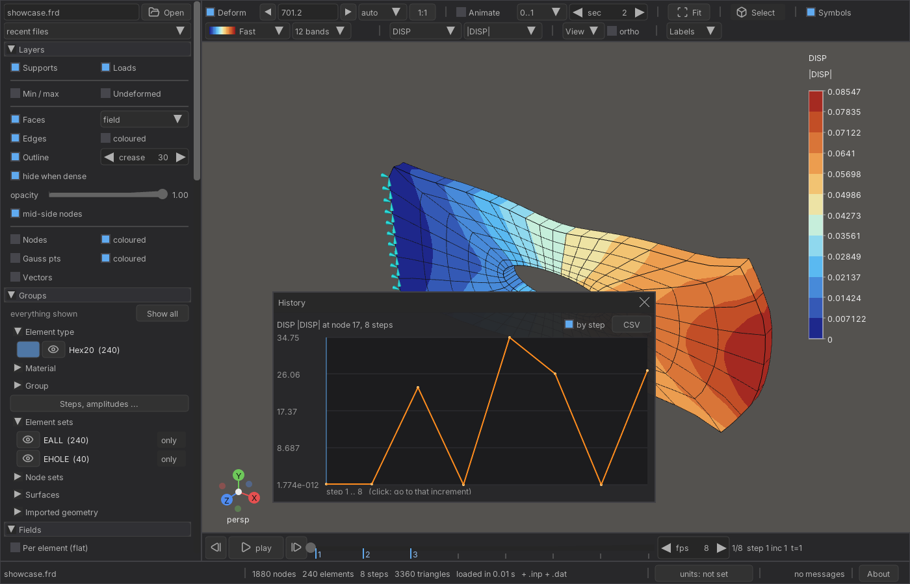

# ccxview

A fast viewer for CalculiX results and models: `.frd`, `.inp`, `.dat` and cgx
`.fbd`. One small executable, no installation.



*Imported STL geometry shown with the results; animation by [@SergioP1975](https://github.com/BasemRajjoub/ccxview/issues/23).*

**Try it in the browser, nothing to install:** https://basemrajjoub.github.io/ccxview/

Download the [latest release](https://github.com/BasemRajjoub/ccxview/releases/latest):
[Linux](https://github.com/BasemRajjoub/ccxview/releases/latest/download/ccxview-linux-x86_64.tar.gz) ·
[Windows](https://github.com/BasemRajjoub/ccxview/releases/latest/download/ccxview-windows-x86_64.zip) ·
[Web, one HTML file](https://github.com/BasemRajjoub/ccxview/releases/latest/download/ccxview-web.zip)

## Fast

| Model | Read | Surface built |
|---|---|---|
| 5 million elements, 800 MB `.frd` | 0.45 s | 0.9 s |
| 1 million elements, 426 MB ASCII `.frd` | 0.6 s | 0.2 s |

Fields are decoded only when shown, everything is drawn on the GPU, a filled
clip plane moves through 5 million elements in 12 ms. About 2 MB or less to
download; runs without a GPU too, and in the browser. Measured on one desktop
PC; `build/bench file.frd` prints the numbers for yours.

## What you get

<table>
<tr>
<td width="50%"><br><b>Results</b>: contours, deformed shape, animation, probe, max and min labels.</td>
<td width="50%"><br><b>Clip plane</b> with a filled cut, crop box, mirror, cyclic symmetry.</td>
</tr>
<tr>
<td><br><b>The deck on the model</b>: supports, loads, bolts, springs, each with its own 3D symbol.</td>
<td><br><b>Contact and ties</b>: pairs, gap and status drawn on the model.</td>
</tr>
<tr>
<td><br><b>Shell forces and reinforcement</b> of concrete shells (sandwich model, Wood-Armer).</td>
<td><br><b>Mesh quality</b>: aspect ratio, Jacobians, skew, warpage, with your own limits.</td>
</tr>
<tr>
<td><br><b>ASME VIII-2 stress linearization</b> between two nodes.</td>
<td><br><b>History and path plots</b>, calculated fields, failure criteria, comparison of two runs.</td>
</tr>
</table>

## Command line

```sh
ccxview model.frd
ccxview model.frd --shot out.png
ccxview model.frd --calc "S1 - S3" --export mp4
```

## More

- [Features in full](docs/features.md)
- [Command line, mouse and keys](docs/usage.md)
- [Deck keywords and symbols](docs/keywords.md)
- [Result fields and what is done with them](docs/results.md)
- [Building, testing, releasing, timings](docs/build.md)
- [Design notes](docs/spec.md)

GPL-3.0-or-later. Vendored libraries and fonts keep their own licences:
[vendor/README.md](vendor/README.md).
