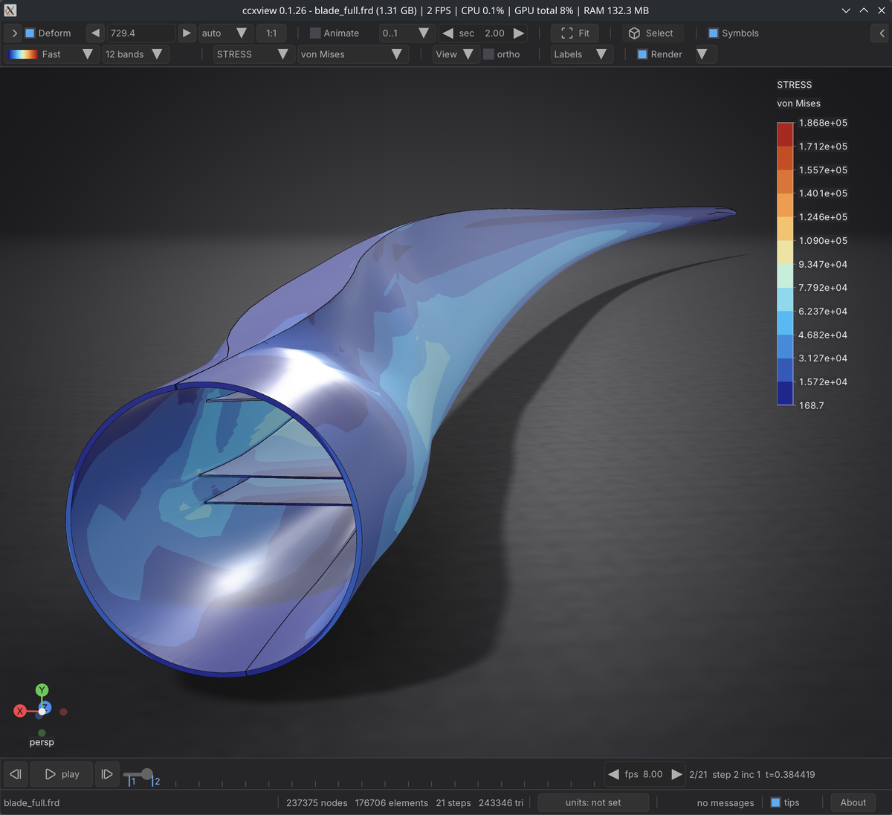

# ccxview

Fast, portable viewer for CalculiX results and models. One small executable written in C, no installation.



**Try it in the browser:** https://basemrajjoub.github.io/ccxview/

**Download:**
[Linux](https://github.com/BasemRajjoub/ccxview/releases/latest/download/ccxview-linux-x86_64.tar.gz) ·
[Windows](https://github.com/BasemRajjoub/ccxview/releases/latest/download/ccxview-windows-x86_64.zip) ·
[macOS](https://github.com/BasemRajjoub/ccxview/releases/latest/download/ccxview-macos-arm64.tar.gz) ·
[Web, one HTML file](https://github.com/BasemRajjoub/ccxview/releases/latest/download/ccxview-web.zip)

## Features

- **Fast:** 5 million elements (800 MB `.frd`) read in 0.45 s; fields decoded only when shown; GPU drawing, software fallback.
- **Portable:** Linux, Windows, macOS, browser; about 2 MB; C99, no dependencies to install.
- **Files:** `.frd` (ASCII, binary), `.inp`, `.dat`, `.sta` / `.cvg`, cgx `.fbd`, `.stl`.
- **Results:** contours, deformed shape, animation, vectors, tensor glyphs, stress trajectories, Gauss points, probe, min / max labels.
- **Render view:** studio light, shadows, floor, ambient occlusion, material looks (steel, aluminium, concrete, ...), one-click rendered image.
- **Cutting:** clip plane with filled cut, crop box, mirror, cyclic symmetry, fly-through.
- **Deck on the model:** supports, loads, bolts, springs, couplings, contact and ties as 3D symbols.
- **Engineering tools:** ASME VIII-2 stress linearization, shell forces and concrete reinforcement, failure criteria, mesh quality, integrals, calculated fields, unit conversion, comparison of two runs.
- **Plots and selection:** history and path plots, box selection, measurements, labels, named sets.
- **Export:** PNG, MP4, GIF, CSV, VTK, model report (Markdown or PDF); everything scriptable from the command line.

```sh
ccxview model.frd
ccxview model.frd --render 64 out.png
ccxview model.frd --calc "S1 - S3" --export mp4
```

## More

- [Features in full](docs/features.md)
- [Command line, mouse and keys](docs/usage.md)
- [Deck keywords and symbols](docs/keywords.md)
- [Result fields](docs/results.md)
- [Building and testing](docs/build.md)
- [Design notes](docs/spec.md)

## Licence

ccxview is source-available under the [PolyForm Small Business License 1.0.0](LICENSE): free for individuals, for companies with fewer than 100 people and under about USD 1 million revenue, and for personal, academic, research, non-profit and government use. Larger companies need a commercial licence: https://basemrajjoub.com/. Vendored libraries keep their own licences: [vendor/README.md](vendor/README.md). Contributions: [CONTRIBUTING.md](CONTRIBUTING.md).
